# MoneyLedger

**License: AGPL-3.0** (or later) — see [`LICENSE`](LICENSE) and
[`THIRD_PARTY_NOTICES.md`](THIRD_PARTY_NOTICES.md). Privacy policy:
[`PRIVACY.md`](PRIVACY.md). Release notes (v1.0.0):
[`docs/release-notes.md`](docs/release-notes.md).

A decentralized expense-sharing app (a Splitwise / Tricount alternative) with
**no central server**. You sign in with your [Matrix](https://matrix.org)
account, and all ledger data — groups, members, expenses, settlements — lives
**only in a local SQLite (Drift) database on each device**. There are no ledger
rooms: Matrix is used purely as an **end-to-end-encrypted to-device relay** to
replicate records between members, so the homeserver retains no financial data
and sees only ciphertext.

- **Works without an account — the default:** choose *Start without an
  account*; groups you don't share stay on this device (no Matrix, no server
  contacted, no sync) — share one with an invite link (below), or connect a
  Matrix account later (the secure mode, explained calmly on a *Why Matrix?*
  page) and your groups move into it.
- **Share a group with an invite link (no account needed):** a link / QR
  code carries the group's key in its `#fragment`; every device publishes its
  copy of the group **end-to-end encrypted** (gzip + AES-256-GCM) to public
  [Nostr](https://nostr.com) relays (by default nos.lol + nostr.mom, one
  operator; your own relay can be added) — they see IP addresses and timing,
  never names or amounts. Anyone with the link can read and change the group;
  Matrix stays the secure mode (accounts, signed records, verified devices).
- **Platforms:** Android and web. **iOS is not supported for v1** (see
  [Platform support](#platform-support)).
- **No backend to run:** bring your own Matrix homeserver (matrix.org, self-hosted, …).
- **Local source of truth:** every device holds the full ledger and computes
  balances locally; peers reconcile via digest-based anti-entropy.
- **Private by design:** records are E2EE (vodozemac); inbound records are
  membership-gated so only group members can write to a group's ledger.

### Features

- **First-open welcome** that explains the app before any login: what it
  does, free + open source, no MoneyLedger server, sharing a group with a
  link, and Matrix as the secure mode — then *Start without an account*,
  *Join with an invite link*, or (secure mode) *Sign in with Matrix* /
  *Create a Matrix account* (re-read it via About → *How MoneyLedger works*
  or the login page's *What is Matrix?*). *Why Matrix?* (from the welcome, a
  link group's ⋮ and once a hint on the groups page) compares the two modes.
- **No account (local mode):** your name + a device-local ledger; other people
  are names only; a *No account* chip explains it (back up regularly!).
  *Settings → Connect a Matrix account* later moves every local group into
  that account (you become its claimed member, every entry is signed by the
  new device) so you can invite people and sync your devices; *Delete local
  data* ends local mode.
- Local-only expense **groups** with Matrix-account or **local (name-only)**
  participants; link a Matrix account to a local person at any time.
- **Custom splits**: equal (pick who), exact amounts, shares/weights, or
  percentages — always summing to the total exactly.
- **Categories + notes** on expenses (10 categories with icons, suggested
  from the description; an optional note), and **search / filter** in a
  group's list (text, category chips, "involving me").
- Multi-currency **balances** with greedy debt simplification (explained in
  the app; each currency is settled separately), plus settlements.
  **Share** "who pays whom" as plain text through the system share sheet
  (e.g. into the trip's chat), and an **overview** per currency: total
  spent, what everyone paid vs. their share, the biggest categories. The
  groups list is sorted by last activity.
- **Fixed exchange rates** per group (group settings → *Exchange rates*,
  entered by hand or with *Fetch current rate*, which asks
  [Frankfurter](https://frankfurter.dev) only when tapped) and *Settle up in
  {currency}*: the other currencies are converted at those rates for the
  balances and suggested payments.
- **Archive** settled groups on this device (⋮ → *Archive group*, or the group settings): they move
  into a collapsed *Archived* section and come back by themselves when
  something new is added.
- **Full backup / restore**: *Settings* (gear) → *Back up all groups* writes one
  JSON file with every group (participants, expenses, payments, deletions);
  *Restore from backup* previews and merges it back (idempotent, newer entries
  win). Your data lives only on your devices — the groups page nudges you when
  a group exists nowhere else (not even on another device of yours) and you
  haven't backed up for 30 days. Optionally **encrypted with a passphrase**
  (Argon2id + AES-256-GCM); without one the file is plain text. A single
  group can be backed up from its group settings (*Back up this group*).
- **CSV export/import** per group (expenses + payments) for spreadsheets and
  sharing, with an import preview that warns about unknown / duplicate names.
- **In-app registration** (open / dummy-UIA homeservers) and **SSO** login.
- **Device verification** (SAS emoji) and a sync-health indicator.
- **English + German** UI (follows the device language, English fallback),
  locale-aware amounts/dates; amount fields accept `,` or `.` as decimal
  separator. About page with version, source link, licenses and privacy policy.
- **Link groups** (no account): *Invite with a link* (QR, share sheet,
  copy) from a local-mode group — or *Create group → Share with an invite
  link* on a Matrix account; opening the link (`https://leostumpf.github.io/
  moneyledger/join#…`, verified Android App Link, or pasted under *Join with
  an invite link*) asks "Which person are you?" and syncs live while the app
  runs (plus the Android background round). *Settings → Relays* lists /
  adds / removes relays; the group's sync sheet shows who published what;
  *Reset invite link* locks out old-link holders. Leaving or deleting a
  link group first asks the relays to delete this device's copy; a backup
  carries the invite key (with a warning). **Mixed groups (G53):** a
  Matrix group can also get an invite link (its members' devices bridge it
  to the relays; changes via the link show as "not verified"), someone who
  joined by link can connect a Matrix account later and keeps their person,
  and once everyone has an account *Make group secure* closes the link.
  Design: [`docs/design/no-login-sharing.md`](docs/design/no-login-sharing.md).
- **Background sync (Android):** devices sync while the app runs and, on
  Android, about every 15 min in the background (WorkManager; network
  connected, battery not low) — so a closed phone still answers its peers and
  new devices. Toggle per account under *Settings* (gear) on the groups screen.
  The web app syncs only while its tab is open.

## Screenshots

Taken from the [offline demo mode](#offline-demo-mode) (Android, 540 px wide;
regenerate after visible UI changes).

| Groups | Group | Balances | Add expense |
|---|---|---|---|
| 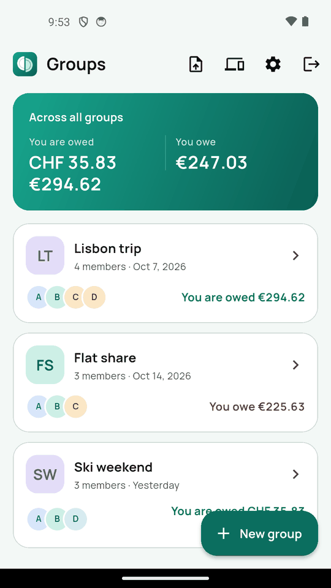 | 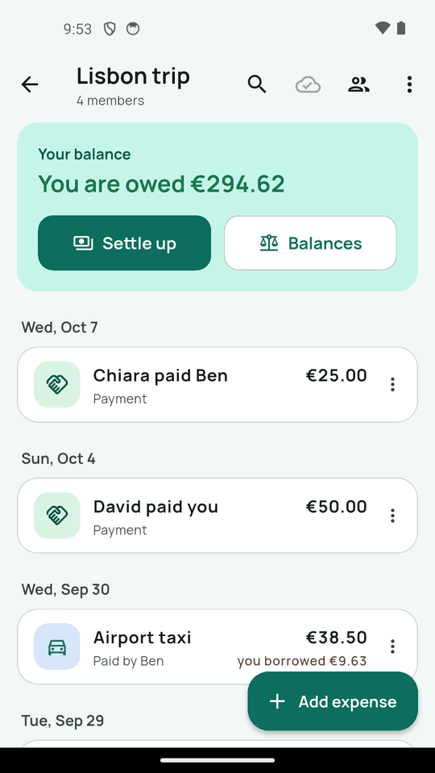 | 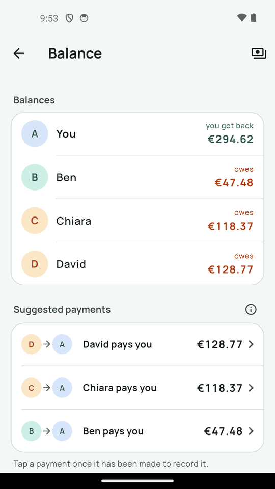 | 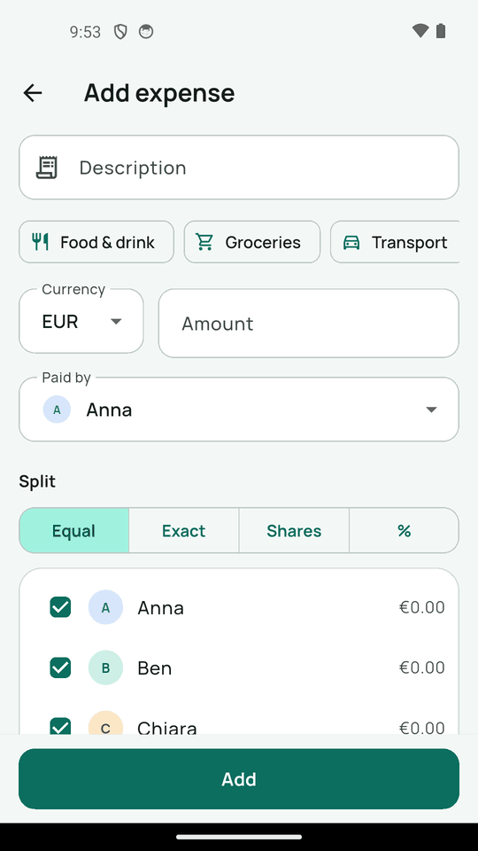 |
| 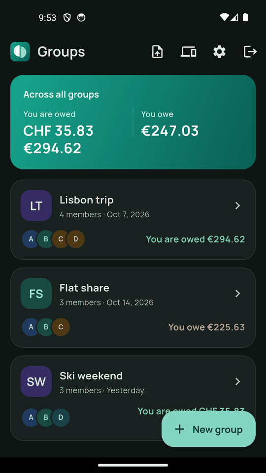 | 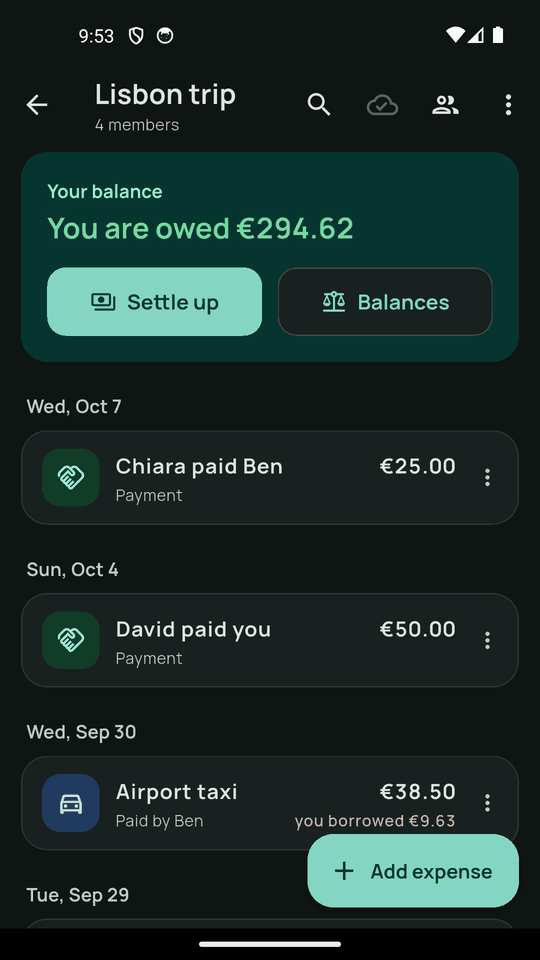 | 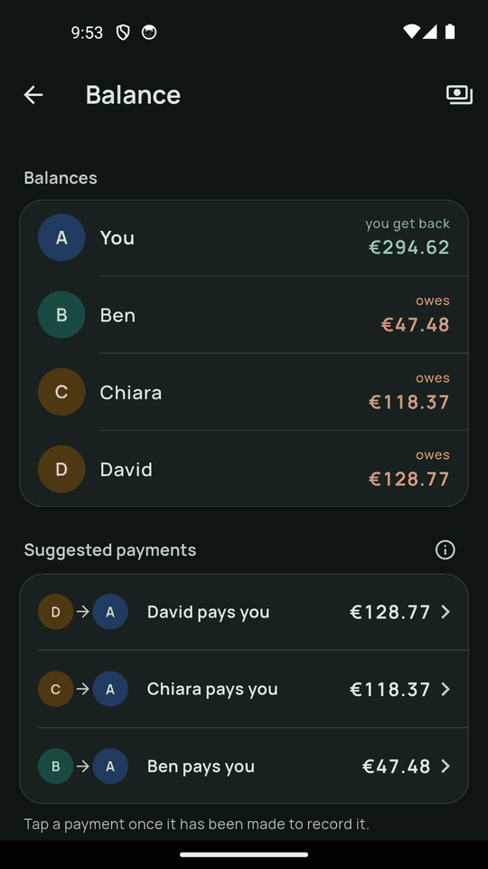 | 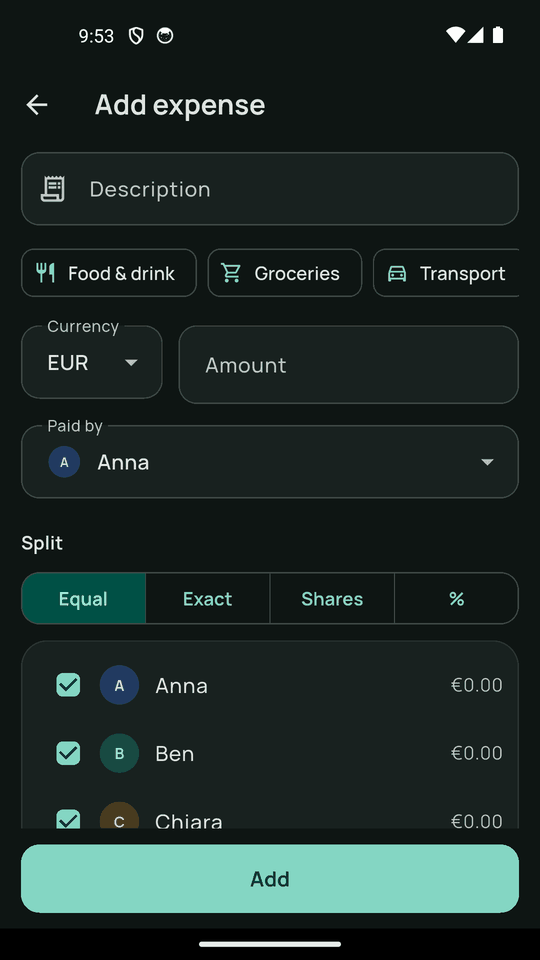 |
| 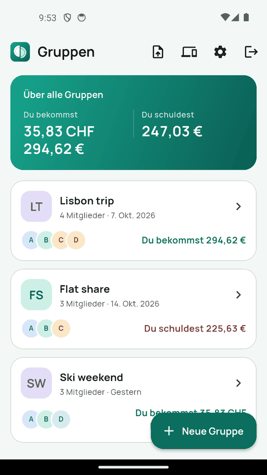 | 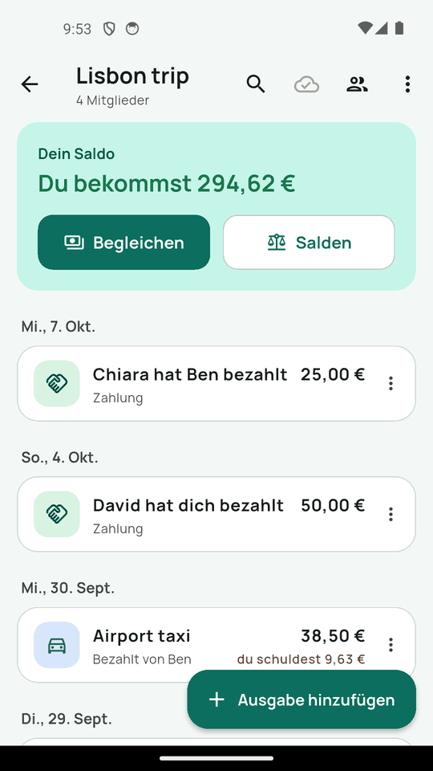 | 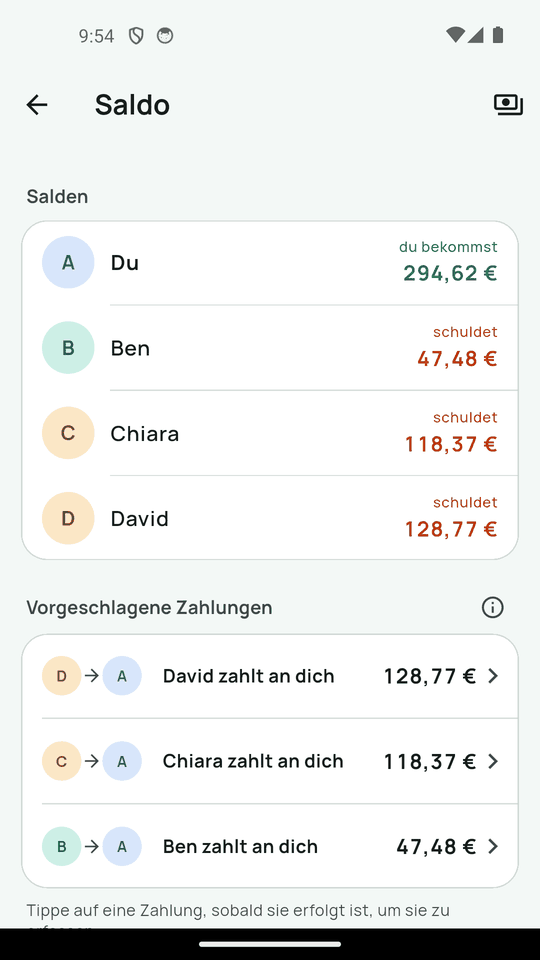 | 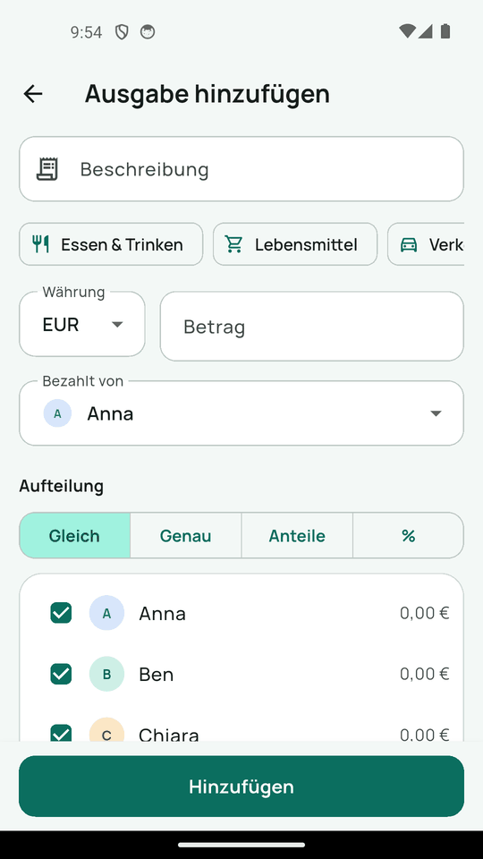 |

*Rows: English (light), English (dark), German (light).*

## Platform support

| Platform | Status |
|----------|--------|
| Android | supported (release APK, tested on device + emulator); app id `io.github.leostumpf.moneyledger` |
| Web | supported (no background sync — syncs while the tab is open) |
| iOS | **not supported for v1** |

iOS has never been built: development happens on Linux (no macOS to build or
sign), and E2EE via `flutter_vodozemac` would need an iOS Rust/XCFramework build
that has not been set up. `ios/Runner` is template level only. The manual
smoke checklist lives in [`docs/smoke-test.md`](docs/smoke-test.md).

## Tech stack

- Flutter 3.44+ / Dart 3.12+
- [`matrix`](https://pub.dev/packages/matrix) 14.x — protocol / transport
- [`flutter_riverpod`](https://pub.dev/packages/flutter_riverpod) 3.x +
  `riverpod_annotation` — code-gen state management
- [`drift`](https://pub.dev/packages/drift) 2.35 — local SQLite ORM (`sqlite3` 3.x)
- [`go_router`](https://pub.dev/packages/go_router) — navigation
- [`share_plus`](https://pub.dev/packages/share_plus) — system share sheet
  (BSD-3-Clause)
- Link groups: [`bip340`](https://pub.dev/packages/bip340) +
  [`pointycastle`](https://pub.dev/packages/pointycastle) (Nostr Schnorr
  signatures, MIT), [`web_socket_channel`](https://pub.dev/packages/web_socket_channel)
  (relays, BSD-3-Clause), [`archive`](https://pub.dev/packages/archive)
  (gzip, MIT), [`cryptography`](https://pub.dev/packages/cryptography) (HKDF +
  AES-GCM, Apache-2.0), [`qr`](https://pub.dev/packages/qr) (invite QR,
  BSD-3-Clause)
- [`image_picker`](https://pub.dev/packages/image_picker) — receipt photo from
  the camera app / photo picker (Android only, kept on this device only — G78;
  BSD-3-Clause)
- `flutter_localizations` + [`intl`](https://pub.dev/packages/intl) — EN/DE
  strings from ARB files (`lib/l10n/`), number/date/currency formatting

## Prerequisites

- Flutter SDK **3.44+** (Dart **3.12+**) — verify with `flutter doctor`.
- Android: Android SDK + NDK and a device or emulator.
- Android: a **Rust toolchain** (`rustup`, **stable**) — E2EE uses
  [`flutter_vodozemac`](https://pub.dev/packages/flutter_vodozemac) (0.8.x),
  which compiles the vodozemac Rust crate during the Gradle build (via cargokit).
  Install from <https://rustup.rs>, then add the Android targets:
  ```bash
  rustup target add aarch64-linux-android armv7-linux-androideabi \
                    x86_64-linux-android i686-linux-android
  ```
  (cargokit tries to `rustup target add` missing targets itself, but
  pre-installing them keeps offline/CI builds deterministic.) Web needs no Rust:
  it uses the prebuilt wasm checked in under `web/pkg/` (rebuilt only when
  `flutter_vodozemac` changes — recipe in CLAUDE.md, "Rebuilding `web/pkg/`").
- iOS: not supported for v1 (see [Platform support](#platform-support)).
- A Matrix account on any homeserver to actually sign in.

## Setup

```bash
git clone https://github.com/LeoStumpf/MoneyLedger.git
cd MoneyLedger
flutter pub get
dart run build_runner build      # generate Drift + Riverpod code (required)
```

This project relies on **code generation** (Drift tables, Riverpod providers). Run
`build_runner` after a fresh clone and after editing any file annotated with
`@riverpod`, `@DriftDatabase`, or `@DriftAccessor`. For continuous regeneration
while developing:

```bash
dart run build_runner watch
```

## Run

```bash
# Web (dev server on http://localhost:8080; add --no-web-resources-cdn to
# load CanvasKit locally like the release build does)
flutter run -d web-server --web-port 8080 --web-hostname 0.0.0.0

# Android (a device/emulator must be connected)
flutter run -d android

flutter devices                  # list available run targets
```

On first launch a short welcome explains the app and lets you choose: *Start
without an account* (local mode), *Join with an invite link*, or — secure
mode — *Sign in with Matrix* (enter your homeserver, e.g. `matrix.org`, then
password or SSO) / *Create a Matrix account*.

### Offline demo mode

```bash
flutter run -d web-server --web-port 8080 --dart-define=OFFLINE_DEMO=true
flutter build apk --release --dart-define=OFFLINE_DEMO=true
```

Starts signed in as "Anna" with a seeded example ledger (*Lisbon trip*,
*Flat share*, *Ski weekend* — EUR + CHF, custom splits, payments — and
*Climbing gym*, a group shared with an invite link) and no
network at all: fake auth, a fake relay, no Matrix client, no background sync,
no Nostr relay (the link group's invite sheet works, its sync shows as done).
The ledger lives in its own `money_ledger_offline_demo` database, reseeded on
every start; real account data is never opened. Meant for screenshots and
quick UI checks. Without the define the code is tree-shaken out.

> Installing a demo APK over the real app replaces the app binary (same
> package id) — the real data stays untouched, but reinstall a normal build
> afterwards. A debug build can't be installed over a release-signed one
> without uninstalling (which deletes the app's data).

## Test

```bash
flutter test --reporter compact                  # whole suite (exit 0 = green)
flutter test test/balance_calculator_test.dart   # a single file
```

Tests run **fully offline** — no real homeserver is involved. Multi-user,
federated, and login flows are exercised against in-memory fakes
(`test/helpers/fake_ledger_network.dart`, `test/helpers/fake_auth_gateway.dart`).
Run the suite before committing; write tests alongside every change.

Tests never wait on the wall clock: timeouts / backoffs take their timers from
an injectable `TimerFactory` (tests fire them via `test/helpers/manual_timers.dart`),
and "wait until the DB write landed" polls with `test/helpers/eventually.dart`
instead of a fixed sleep — so the suite doesn't flake on a loaded machine.

CI (`.github/workflows/ci.yml`, GitHub Actions) runs on every push / PR to
`main`: codegen + "no generated diff", format check, `flutter analyze`, the
test suite and the web release build. The Android build isn't part of CI (it
needs the Rust toolchain + NDK).

## Build (release)

```bash
./build.sh        # one-liner: pub get → codegen → format check → tests → web release build
```

`build.sh` runs `flutter pub get` → `dart run build_runner build` →
`dart format --output=none --set-exit-if-changed lib test` → `flutter test` →
`flutter build web --release --no-web-resources-cdn` → `tool/web/check_web_build.sh`,
stopping on the first failure — so a green run means codegen, formatting, all
tests, and the release build passed. The code is
kept `dart format`ted (generated files included — the generators emit
formatted code); fix a failing check with `dart format lib test`. Output
lands in `build/web/`. Override the Flutter binary with
`FLUTTER=/path/to/flutter ./build.sh`.

Per-platform release builds:

```bash
flutter build web --release --no-web-resources-cdn   # → build/web/
flutter build apk --release      # → build/app/outputs/flutter-apk/
```

> The web build needs `web/sqlite3.wasm` and `web/drift_worker.js` (checked in,
> not generated; taken from the matching drift GitHub release) — don't delete them.

> **No CDN (G43):** always build the web app with `--no-web-resources-cdn`, so
> CanvasKit is served from `build/web/canvaskit/` instead of `www.gstatic.com`.
> `web/flutter_bootstrap.js` points the engine's font downloads at `fonts/` on
> the app's own origin (Roboto lives in `web/fonts/`; SAS emoji + symbol
> fallbacks are web-only assets), so the browser never contacts Google.
> `tool/web/check_web_build.sh build/web` verifies a build (build.sh + CI run
> it); after a Flutter upgrade it may ask you to re-run
> `python3 -I tool/fonts/make_web_fonts.py` for a new engine Roboto path.

### Release signing (Android)

Release APKs/App Bundles are signed with an **upload keystore** that lives
**outside the repo** (`~/moneyledger-upload-keystore.jks`, alias `upload`).
Gradle reads it via `android/key.properties`, which is **gitignored** (as are
`*.jks` / `*.keystore`):

```properties
storePassword=<store password>
keyPassword=<key password>
keyAlias=upload
storeFile=/home/<you>/moneyledger-upload-keystore.jks
```

**Back up the keystore and its password** (e.g. password manager + offline copy).
Losing it means you can never ship an update under the same signature — Play
Store updates become impossible and sideloaded users would have to uninstall
(losing local data) to install a newly signed build.

If `android/key.properties` is absent (dev machines, CI without secrets), the
release build falls back to the **debug key** so `flutter build apk --release`
still works — such APKs are for testing only, never for distribution.

### Invite-link landing page + App Links

Invite links (`https://leostumpf.github.io/moneyledger/join#…`) open the app
directly once Android has verified the App Link
(`android:autoVerify="true"` in the manifest). The verification file
`https://leostumpf.github.io/.well-known/assetlinks.json` and the landing
page shown without the app (`moneyledger/join.html` — reads the `#fragment`
in the browser only and offers *Open in MoneyLedger*) live in the separate
user-site repo `LeoStumpf.github.io` (shared by all of Leo's apps; see its
README). `assetlinks.json` lists the **upload key**'s SHA-256 fingerprint;
add the Play App Signing key's once the app is enrolled. Until the site is
live (or for builds signed with another key) the https link opens the
browser unless *Open by default* is set by hand; `moneyledger://join#…`
always works.

## Localization

UI strings live in `lib/l10n/app_en.arb` (template) and `lib/l10n/app_de.arb`.
To add or change a string, edit **both** ARB files and run `flutter gen-l10n`
(also run automatically by `flutter pub get` / `flutter run` / `flutter build`);
the generated `lib/l10n/app_localizations*.dart` files are committed. Use it in
widgets as `context.l10n.myKey` (`import 'core/l10n/l10n.dart'`). The CSV
export and the JSON backup stay machine format (dot decimals, ISO dates) in
every language.

## Architecture & contributing

See [`CLAUDE.md`](CLAUDE.md) for the architecture, the Matrix↔app concept mapping,
the data model, and the project structure. Known gaps and planned work are tracked
in [`docs/open-points.md`](docs/open-points.md).
